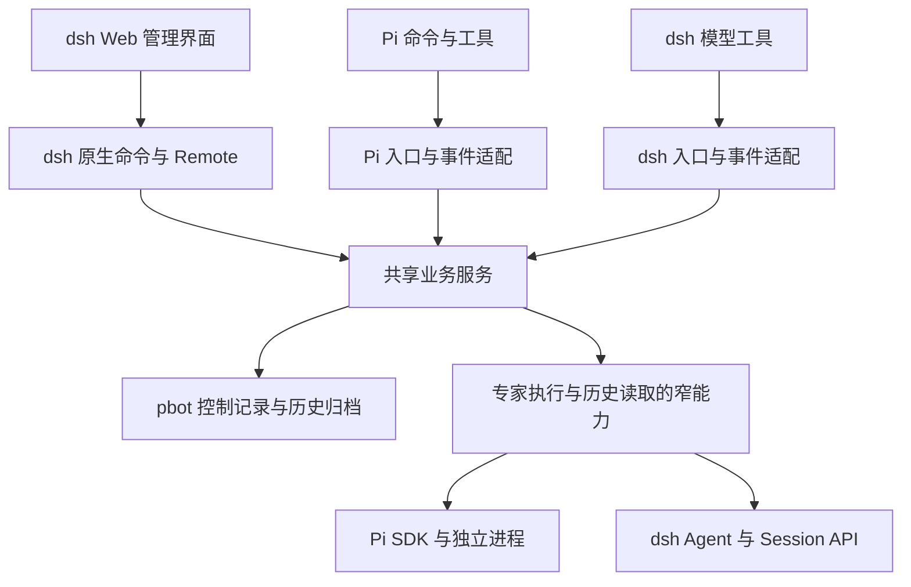

# Pi 与 dsh 双宿主支持方案

状态：Q1–Q13 已确认，设计树已收敛。用户已授权编写技术方案并开始执行；实施步骤与进度见[实施技术方案](dsh-implementation-plan.md)。

目标：保留 Pi 的现有能力，同时在 dsh Web 中提供完整的 Personal Bot。复用业务服务和资料，只适配宿主实际不同的注册、执行、存储引用、生命周期和界面。

## 已确认决策

| 决策 | 内容 |
| --- | --- |
| Q1 能力范围 | 覆盖全部现有能力，包括资料、角色与技能、Python、独立专家、团队、history 和人工管理 |
| Q2 首个入口 | 以 dsh Web 为使用与验收入口 |
| Q3 会话归属 | 原生会话由创建它的宿主管理，不跨宿主接管或恢复 |
| Q4 安装 | 使用 dsh 原生插件安装；首版不扩展 `pbot setup` 的 dsh 安装流程 |
| Q5 配置共享 | 业务约定、用户偏好、角色补充、专业方法和提供方手册共用文件；模型、认证、插件加载和 MCP 连接分别原生管理 |
| Q6 历史共享 | 两端共同查询问答、摘要和关系；各自收录和生成自己来源的摘要，保留旧 Pi 归档和节点身份 |
| Q7 生命周期 | 页面切换、刷新和关闭浏览器不主动停止已授权工作；服务端资源关闭时清理执行，重启不自动重放旧任务 |
| Q8 版本基线 | 用户安装跟随 dsh `latest`，不精确锁定宿主；`0.2.2-rc.1` 为最低版本及当前开发、验收基线，开发依赖与锁文件保留精确版本；当前 dsh 要求 Node.js ≥24.9.0 |
| Q9 专家执行 | dsh 在同一服务进程内创建独立原生 Agent / Session；Pi 保留独立进程和 tmux |
| Q10 加载范围 | 从原生 Web 模板创建独立 `pbot` profile，可承载多个工作区 |
| Q11 兼容标准 | 业务操作含义一致；模型、思考强度和资源选项按宿主原生能力表达，不支持的输入明确拒绝 |
| Q12 人工操作 | `/pbot` 配合原生菜单和轻量管理界面；人工操作调用同一业务服务 |
| Q13 分发 | 一个 npm 包和统一版本，分别提供 Pi 入口、dsh 服务端入口及 Web 客户端模块 |

设计树没有剩余的用户选项。下文把上述决定落实为实现边界和验收条件；运行验证仍是实施阶段的工作，不把静态核查视为通过验收。版本策略已按后续使用要求调整为跟随 `latest`；下文 `0.2.2-rc.1` 的接口说明及固定版本资料链接保留首轮实现依据，当前命令以中英文使用指南和实际安装版本为准。

```text
保留 Pi，同时支持 dsh
├─ 业务能力完整
│  ├─ 资料、职责、专业方法共用
│  ├─ 专家与团队规则共用，执行按宿主适配
│  ├─ Python 用户 venv 共用，激活生命周期分别管理
│  └─ 工具含义一致，原生选项分别校验
├─ dsh Web 入口
│  ├─ 独立 pbot profile
│  ├─ 命令、专家、团队、history 视图
│  └─ 服务端执行独立于页面观察
├─ 资料与历史共享
│  ├─ history 共同查询，各自写入
│  ├─ 原生配置与会话分别管理
│  └─ 旧 Pi 记录保留，不迁移或接管
└─ 单包分发
   ├─ Pi 源码入口
   ├─ dsh 服务端与客户端构建产物
   └─ 原生安装跟随 latest，验收记录实际版本
```

## 架构与最小改动

继续保留 `tools / services / model / integrations / storage / extension / ui` 顶层分层。按责任划分代码，不新增通用 Host 平台、动态插件发现、配置同步框架或第二套模型循环。



| 部分 | 现状 | 必要改动 |
| --- | --- | --- |
| 入口 | `src/pbot.ts` 装配 Pi | 保留该入口，新增 `src/dsh.ts`；分别明确注册，不按运行环境猜测宿主 |
| 工具 | 各领域 `contract.ts`、`tool.ts` 含 Pi 类型及注册 | 共享普通数据、JSON Schema、action 校验和业务处理；Pi/dsh 执行适配仍放在相应工具领域内，服务不接收宿主 context |
| 专家服务 | `AgentService` 不导入 Pi，但 `AgentHost` 为同步操作且显式传会话文件 | 将创建、恢复、原生验证和报告读取改为必要的异步边界；会话文件或原生 ID 的解析归接入层 |
| 专家运行规则 | `extension/subagent-entry.ts` 含领取、周期、人工输入归因和中断记录 | 将两端需要的状态规则提取到 `services/agents/`；Pi 事件、SDK 消息和 dsh 事件分别转换为普通输入，避免复制一套状态机 |
| 团队与通知 | `TeamService` 管理轮次，父侧事件文件连接扫描与通知 | 保留团队算法；共享调度及通知选择规则，宿主分别负责触发、写入原生上下文和读取领取记录 |
| 历史 | `HistorySource` 已隔离 Pi 提取；服务按单一 sessionId 关联 | 增加来源身份及读写范围，复用分组、搜索和分页；新增 `integrations/dsh/history.ts` |
| 生命周期 | Pi `Lifecycle` 只有一个 active 实例，实例持有 Python 激活 | 保留 Pi 行为；在 `extension/dsh/` 按父会话管理实例，按工作区共享历史服务，按服务进程持有 Python 激活 |
| UI | Pi 命令与 TUI 直接连接 | 保留 Pi UI；新增 `ui/dsh/` 客户端模块，`extension/dsh/` 提供实际需要的领域 Remote 接口 |
| 接入 | Pi 原生调用集中在 `integrations/pi/` | 新增 `integrations/dsh/`，处理 Agent、Session、模型选择、附件和原生事件 |
| 分发 | Pi 加载源码，安装 CLI 使用 `lib`，`dist` 仅供测试 | 增加 dsh 服务端和客户端构建，以及 bundle patch；更新依赖边界检查，防止 Pi 加载链引入 dsh/浏览器依赖 |

工作区准备、Python 依赖准备、团队轮次算法和文件授权规则继续复用。现有 Pi 文件不做无关搬迁。`model` 只承载普通数据，不导入任一宿主 SDK；已有 `AgentHost`、`HistorySource` 是扩展点，不为其他假想宿主增加接口。

## 全部能力映射

| 能力 | dsh 落点 | 保留的行为 |
| --- | --- | --- |
| 工作区资料 | `/pbot init` 调用 `prepareWorkspace` | 补建资料，保留已有文件；加载不等于初始化，不创建启用状态 |
| 状态 | `/pbot status` 与会话上下文 | 展示工作区、cwd、版本和 Python 状态，区分当前目录与资料所属工作区 |
| 协调者与专家职责 | 原生 system prompt section/context | 共用公共约定及 `coordinator.md`、`general-purpose.md`；加载同名工作区补充 |
| 技能与参考 | 原生 skill filesystem provider 的附加资源目录 | 共用专业方法正文，按需加载；宿主操作指南分别提供 |
| 原生工具 | dsh tools、Bash、文件与附件 API | 保留原生结果和取消语义；不新增计算工具或泛化调用代理 |
| 外部 CLI/MCP | CLI 自有配置；dsh 原生 MCP 插件与配置 | 不复制 Pi 认证或连接声明，不建立私有 MCP 客户端；可选 Task Conductor 继续直接接入主会话 |
| 共享 Python | 现有准备服务和用户 venv；服务端组件持有激活 | 自动准备、失败可见、显式重试；不改变系统 Python，项目构建使用其声明的环境 |
| `pbot_agent` | 同进程独立 Agent / Session | `start/send/rename/status/list/read/stop/resume` 全部保留；无任务 start 待命，不调用模型 |
| 初始附件 | dsh 原生文件读取与附件能力 | 文件按工作区解析，保留绝对来源、图像、截断和续读信息；不继承父聊天 |
| 专家人工进入 | pbot 专家视图和服务端操作 | 浏览原生内容、直接对话、补充要求、重命名、停止和显式恢复；只看历史不恢复专家 |
| `pbot_team` | 现有 `TeamService` | `create/list/status/read/run/pause/close`、固定成员、有限轮次、roundRobin/parallel 和期限保留 |
| `pbot_team_message` | 主/子会话显式注册的 read/post | 署名与来源由服务确定，公共原文直接交换，普通 post 不额外唤醒模型 |
| 完成报告与通知 | 原生持久事件、固定结束位置和 pbot 领取记录 | 不以 idle 判成功；旧报告不被后续答复替换；团队周期不重复发个人完成通知 |
| `pbot_history` | 两种来源归档共同查询 | search/read、正文和关系分页、四叉摘要、来源引用及未完成状态保留 |
| 文件确认 | 原生 `tools/pre-execute` 与 approval | 主会话工作区外 write/edit 需要确认；专家直接拒绝同类越界修改，保持当前范围 |
| 多会话 | 按确切父 Session 绑定实例 | 切换页面不释放后台工作；fork 不接管原会话的专家或团队 |
| 安装与客户端 | 原生 profile/bundle/client 模块 | 单包发布；未来客户端可复用服务端业务接口，首版以 Web 验收 |

“能力完整”以业务行为和结果核对，不要求界面控件或启动参数逐字相同。Pi 的 `noExtensions`、`noPromptTemplates` 等参数没有 dsh 对应含义时不出现在 dsh 契约中；误传时报错。模型、思考强度、工具和资源选择由接入层按当前宿主能力校验，不维护 pbot 模型目录。

## 工作区、资源与配置

普通资料共用工作区内的 `AGENTS.md`、`agents/`、项目、知识及 `providers/` 手册。专业方法使用同一份包内正文或工作区 `.agents/skills/`，各宿主按自己的资源机制发现。Pi 专属命令从公共方法中分离到宿主指南，避免 dsh 会话收到不可执行的 Pi 操作步骤。

dsh bundle 为独立 profile 配置默认的 pbot 会话组合，复用必要的原生文件、Bash、技能、模型和 Web 能力。专家组合复用原生基础能力，加入 general-purpose 职责和团队通信，排除 pbot 管理工具及递归委派。不会以 dsh 同名 subagent 或团队功能替换 pbot 业务。

每个父会话在创建或加载时固定规范工作区根目录。后续改变执行 cwd 不转移资料或团队归属，也不修改进程全局 cwd。子会话的 cwd 可不同于资料工作区；原生工具和 MCP 的实际配置作用域按该宿主说明处理，不能声称它继承了另一宿主或另一会话的临时配置。

0.2.2-rc.1 已发布的 MCP 接入是 `@deepseek-ai/dsh-mcp-client`：每个服务器一条原生配置，支持 stdio 和 Streamable HTTP，并通过原生作用域暴露工具。使用该版接口及配置管理，不照搬后续主干的 `mcp-manager` 说明。默认不增加任何外部服务器，也不导入旧配置或凭据。

## 专家执行、报告与团队

### 创建与投递

使用 `ctx.agents.create({ sessionId, parentAgent, meta, agentOptions, setup })` 创建专家。`agentId` 对应本宿主的原生 session ID；元数据记录 cwd、直接父会话和子会话来源，运行时也校验父级归属。setup 在发布 Agent 前安装职责、工具、上下文和监听器，创建完成后才接收新工作。

dsh 持久层允许空会话延迟落盘。首次 start 对外确认成功前，使用公开的原生持久化屏障确保该会话可在进程重启后读取，不通过伪造用户或助手消息促使落盘。pbot 完成记录也只能在对应原生结束位置确认持久化后发布；写入失败保留故障状态，不宣布交付完成。

父会话最多 50 个存活专家，含待命与正在启动的实例。并发 start/resume 必须串行完成同一父会话的限额准入，并按专家 ID 排除重复创建和恢复。异步原生操作不能直接放入现有同步 `.control` 回调：先在短锁内保存准入结果和 generation，再执行原生调用，完成后重新检查实例、generation、stop 和归属；失效时释放新句柄，不发布可用状态。

pbot inbox 继续保存请求及团队关联。当前运行组件领取当前 generation 的请求，再调用原生 `steer` 或 `followup`；原生消息携带可核对的请求身份。原生 inbox 负责模型步骤边界，pbot 记录负责工作请求及业务状态。接收、领取、实际消费和成功交付分别记录，不因入队回执宣称完成。

### 周期与固定报告

使用实际消费记录、持久轮次结束原因和最终 assistant 答复判定周期结果。0.2.2-rc.1 的 `foldConsumedWork` 可辅助区分已消费工作与未执行即取消的输入；它不能替代 pbot 的逐请求关联。`whenIdle()`、`agent/status` 或临时 claimed 事件本身都不是成功证明。

完成记录固定原生结束位置。Pi 继续使用原有 leaf；dsh 将原生持久事件位置编码为接入层解释的固定引用。共享服务不解析事件序号或 Pi 消息结构。读取旧周期时只读取对应结束位置内的最终答复；后续对话、取消、模型错误和空闲都不能覆盖旧报告。

父侧输入保留 `parent` 来源，专家视图中的直接人工对话保留 `interactive` 来源；同周期混合则为 `mixed`。协调者的 send/steer 继续受 `TEAM_BUSY` 约束。直接人工介入团队周期时，沿用当前 mixed 规则：暂停团队，不自动公开混合答复，已显式 post 的公共内容保留。这项规则在共享业务运行逻辑中执行，不能由浏览器自行判断。

### 团队与通知

复用当前固定成员、轮次、并发、期限、领取、暂停及关闭规则。仍先保存团队请求关联，再发布输入。崩溃窗口内无法确认是否执行的请求保留为未知或中断，不自动重发。

团队原文在模型下一安全边界加入原生上下文；注入不应独立开启额外轮次。消息分页、原文保真和上下文预算沿用现有规则。正常完成的团队报告自动公开，普通 post 不增加工作请求。

父会话的结果通知通过原生持久消息或事件记录交付身份。按 agent/cycle、team/run/状态去重；模型 read 的领取与 UI 浏览分开，status 不领取报告。后台扫描错误仍按可重试、需修复、需重新加载区分；重连后查询状态，不能只依赖客户端临时通知。

### 停止与恢复

stop 保持非阻塞的操作语义：先记录停止要求，再取消该专家的输入和执行，等待拥有的 `AgentHandle.dispose()` 完成。只有真实释放或有结束证据后才能解除在途占用。dsh 同进程内不能像 Pi 子进程一样强杀单个 Agent；取消或释放受阻时保持 stopping/故障状态并报告，不能假称已停止。

resume 只针对本宿主、同一工作区和原父会话拥有的停止记录。先验证原生 session 身份与 cwd，再准备新 generation；在恢复 setup 阶段核对并清除旧原生待处理输入，随后才允许新要求进入。旧 pbot generation 的输入不再领取，旧团队批次不续排。缺失、损坏、被其他写者占用或身份不符时明确失败，不新建空白会话代替历史。

加载旧记录和浏览历史不恢复执行。Pi 的“进入已停止 TUI 后待命”行为保留；dsh 专家视图可以直接读停止会话，只有显式恢复并提出新要求才启动其执行。

## 生命周期与共享资源

| 作用域 | 所有者与资源 |
| --- | --- |
| dsh 服务进程中的 pbot 组件 | Python 准备与激活、原生注册和按工作区复用的历史服务 |
| 规范工作区 | 历史归档读取、收录和摘要写入协调；不同父会话不各建一个竞争的整理器 |
| 父 Session | 专家及团队业务实例、调度与通知、实例关闭信号 |
| 专家 | 原生 AgentHandle、会话观察、当前 generation 和周期 |
| 浏览器视图 | 选择、草稿和观察订阅；不持有服务端执行生命周期 |

| 事件 | dsh 行为 |
| --- | --- |
| 导航、刷新、关闭浏览器 | 释放客户端观察，已接纳工作继续 |
| 主会话停止当前回答 | 按主中断规则暂停团队新安排，已领取工作按实际取消和完成状态收尾；不等同于关闭父会话 |
| 显式终止父会话或释放所属实例 | 暂停团队、取消输入、释放所属专家和观察；其他父会话继续 |
| fork | 新父 Session 不继承原专家或团队操作权 |
| 客户端模块热重载 | 重建界面和订阅，查询服务端状态 |
| pbot 执行组件卸载/重载或 Agent 工厂卸载 | 停止所属专家，保留记录；再次加载不自动继续旧任务 |
| dsh 服务退出或异常终止 | 原生持久层及控制记录保留；下次加载核对中断状态，恢复需新要求 |

服务端接纳工作后，执行使用所属实例的信号，不继续借用浏览器请求的存活期。尚未接纳的变更可取消；断连后结果不明时先查询，不自动重复提交。所有旧工具、Remote 调用和异步回调都需检查实例与 generation，防止卸载后继续写入。

Python 沿用当前用户的一份 venv 和跨进程 setup 锁。独立 profile 的服务端组件统一准备并激活，单个会话关闭不恢复进程环境。发布包的本地 Bash 使用 `bash -c`，经 subprocess 在启动时读取当前进程环境，保留 PATH/VIRTUAL_ENV；这与用于配置值的不可变 launch environment 是不同路径。实际解释器、依赖、cwd 及多会话释放仍须运行验证。

激活影响该服务进程后续启动的本地子进程。项目构建和测试继续使用项目声明的环境；准备失败报告未就绪，其他能力可用，`/pbot python setup` 可重试。最后由拥有激活的组件恢复仍归它持有的环境值。不会通过仅允许 `DSH_*` 的 `shellEnv` 注入 PATH，也不新增 shell 执行器。

## 存储与跨宿主 history

### 专家与团队

Pi 继续使用原有用户目录、控制记录、`session-ref.json` 及原生会话位置。现有子会话持久契约在当前兼容线内保持不变，不添加存储版本计数器，不迁移、导入或删除旧记录。

dsh 的控制记录放在原生解析出的 DSH home 下 `pbot/subagents/`，与 Pi 目录分开；团队沿用现有相邻目录布局。descriptor、generation、inbox、cycle、团队关联等业务记录尽量共用现有格式。原生引用由宿主接入管理：Pi 保留绝对文件引用，dsh 独立保存其原生 Session 身份，不把 ID 填进 Pi 的文件字段，也不写占位 JSONL。

原生会话正文由宿主持有。pbot 读取 dsh session query/persistence API，不依赖其私有目录或 JSONL 布局；只读访问不迁移、修复或写回原生日志。需要宿主迁移的记录报告诊断，已有归档仍可读。dsh 子会话使用明确的父级来源，避免停止后被普通会话路由静默接管；pbot 不伪造内置 subagent 管理器的专属 descriptor。

### 归档与查询

| 位置 | 内容与写入者 |
| --- | --- |
| 工作区 `.pi/pbot/history/` | 现有 Pi 问答、摘要和节点；由 Pi 维护 |
| 工作区 `.dsh/pbot/history/` | dsh 问答、摘要和节点；由 dsh 维护 |
| 两端查询 | 读取上述两种归档，结果标注来源；不扫描另一宿主原生会话或替它生成摘要 |

新目录只保存历史资料，不表示工作区启用状态，也不是需要升级的工作区格式。复制两处归档即可保留共同查询能力；原生恢复仍需要本宿主记录。

来源在查询与内存索引中明确为 Pi/dsh，关联键为来源与 sessionId。来源可由归档目录确定，不为标注来源重写旧 Pi 记录。旧 Pi 节点 ID 保持可用；新 dsh 归档根 ID 使用 `dsh-<uuid>`，其节点沿用现有分层标识规则。`pbot_history search` 增加可选 `host: "pi" | "dsh"`，省略时查询双方；命中节点、导航节点及 read 的 source 返回 host。原有 sessionId、entryIds、分页字段和 Pi 节点 ID 保持含义，按来源与 sessionId 联合筛选避免同名 ID 误关联。

收录保留问答原文、补充输入、未完成状态、分层摘要、父子关系与原始消息引用。工具日志、推理和图片二进制不进入 history。专家人工视图读取完整原生记录，不能用 history 归档替代它。dsh 的持久事件序号由历史接入层转换为稳定消息引用，原生 fork 的历史按实际边界提取，不猜测隐藏结果。

收录和摘要只写当前宿主目录。查询刷新双方归档，但不启动模型。主交互正常结束后的空闲阶段，以发起整理的本宿主模型补齐摘要；新输入优先取消相应摘要工作。加载、打开历史视图和恢复网络都不自动启动摘要调用。

dsh 摘要接入使用原生 `llm.prepareCall` / stream，以当前模型选择和认证执行独立的纯文本调用，不新建专家或写入主会话对话。复用现有摘要方法、分段预算及失败保留规则；只在得到有效终止状态与非空正文后保存摘要。摘要是额外模型调用，其实际用量和质量在模型验收中记录。

同一进程对同一工作区复用整理器；扫描和摘要提交使用按来源分开的短写锁。模型调用在锁外进行，写回时读取最新记录并核对摘要输入对应的原文与子节点，过期结果丢弃，避免整份旧记录覆盖新增问答。多进程下不承诺摘要调用恰好一次。源缺失时保留归档；单一来源不可读时报告来源明确的警告，并尽量提供另一来源的可读内容。

此次不新增旧布局导入流程。现有 Pi 对自身历史的兼容读取行为保持原范围，dsh 不触发 Pi 的旧目录复制或字段清理。

## Web 人工管理与客户端复用

`/pbot` 服务端命令直接调用业务服务，不需要模型解释命令。客户端通过 `commandUi.decorate` 等原生机制提供菜单和必要视图：

- 专家：状态列表、原生会话记录、直接输入、协调者补充要求、重命名、停止及显式恢复。工具调用和错误记录可核对，长内容分页；只读查看不领取模型通知。
- 团队：状态、公共原文分页、post、新批次、pause、close，以及所属专家入口。
- history：两种来源的会话与节点搜索、正文分页、父子展开；查看器不修改归档。
- 工作区：init、status 和 python setup；异步操作展示真实状态和失败原因。

底层创建的 pbot 专家不会自动出现在 dsh 内置 subagent 管理器中。该版本普通 Session 控制 API 会拒绝父级拥有的专家，内置 subagent 历史地址又要求其专属身份投影。因此完整人工入口是 pbot 视图，通过原生查询读取内容，通过 pbot 业务入口操作；不承诺直接使用普通聊天输入框接管专家。

浏览器和服务端之间只增加上述领域操作需要的查询、操作与状态观察接口。使用 dsh 原生 Remote 注册、传输、访问控制和重连机制；身份解析后仍由服务核对工作区、父会话及 generation。只读接口使用不激活 Agent 的读取路径；不能为方便获取 context 而自动恢复停止会话。不会再启动 pbot HTTP 服务或提供任意工具调用代理。

文件确认沿用当前职责：主会话的原生 write/edit 在解析实际路径后调用现有文件授权逻辑，dsh 字段为 `file_path`；专家越界修改直接拒绝。模型工具执行中的确认可使用原生 approval，其 API 要求开放轮次；确有确认需求的人工命令使用客户端交互。取消或缺少回答不能视为同意。这些机制不构成 Bash、Python 或扩展的宿主隔离。

独立 profile 是服务端组合边界。未来客户端若复用 dsh Web 组合，可复用客户端模块；使用其他界面时可接入同一服务端领域接口。`dsh-sdk-client` 是另一种进程托管方式：它通过 stdio 启动运行时，`close()` 会关闭该进程。要求客户端关闭后工作继续时，应连接独立常驻服务。具体 Desktop 或自建客户端的安装、托管和体验留待其需求确定，本次不额外建设客户端框架。

## 分发与原生安装

保留 `personal-bot` 一个包和统一版本。Pi 保留 `pi.extensions` 的源码入口，独立安装 CLI 保留现有预构建入口。新增 `personal-bot/dsh` 服务端导出、`./client` 浏览器导出和 `dsh.bundle.patch` 声明；`dsh.client.platform` 为 `web`。

dsh 服务端产物使用 ESM。浏览器产物按 0.2.2-rc.1 的客户端 module loader 格式构建，明确列出外部模块和依赖；复用宿主的 Cordis、React 与原生 UI 模块。首版使用一个客户端 bundle，构建不能依赖开发机旁边的 dsh monorepo。宿主 SDK 声明为可选 peer，开发与验收依赖锁定版本，不在插件内打包另一份运行时。

完整双宿主开发和 CI 使用 Linux、Node.js ≥24.9.0。包的 Pi 消费路径及安装 CLI 保留 Node.js ≥22.19.0 的要求；dsh 入口声明并检查自己的兼容范围。`prepack` 生成 CLI、dsh 服务端和客户端产物，`dist` 仍不进入发布包。此次不预先指定 Personal Bot 发布版本，不改变已有兼容线规则。

2026-11-06 发布的 `personal-bot@0.2.6` 已包含上述 dsh Host/Web 入口。跟随 `latest` 的 dsh、pnpm 安装、插件更新及 tarball 使用步骤统一见[dsh 中文指南](dsh.md)与[英文指南](dsh.en.md)；已完成的 CI、发布检查与尚未完成的全新 registry 安装、真实模型验收见[验证](validation.md)。

`--from-default-profile` 会替换同名自定义 profile，不能作为重复安装或升级命令。已有 profile 只使用原生插件管理更新包，保留用户层配置。配置 dump 不启动 Agent，但会准备 profile 文件，不能将其描述为完全无写入操作。

bundle 只组合所需原生插件、默认 pbot 会话组合、服务端接入和客户端依赖。原生 patch 替换 config 时需提供完整目标值，不能假设深度合并。模型和认证仍通过 dsh 原生方式配置；`pbot setup` 不接管这套流程。

## 实施顺序与验收

以下顺序已获用户授权。第一步先验证已选宿主接口能承载方案，再扩大共享服务改动。

1. **接入验证**：在隔离的 dsh home 和临时工作区安装预构建插件，验证原生命令、客户端加载、无任务 Agent 创建/释放、只读会话查询、恢复 setup 清理旧 inbox，以及原生 Bash 的 venv 继承。使用真实 SDK，不配置模型凭据。
2. **提取必要公共逻辑**：抽离工具业务契约、专家运行状态规则与原生会话引用；Pi 使用新的窄边界但保持行为和持久记录。执行 Pi 回归，避免与 dsh 实现同时失去参照。
3. **完成 dsh 业务接入**：实现专家、团队、通知、文件确认、资源及多会话生命周期；旧请求不自动重放。
4. **完成共同 history 与 Web 管理**：增加来源、独立写入、共享查询和管理视图；验证并发及断连后的状态恢复。
5. **打包与双宿主验收**：真实 tarball 分别加载，完成下列条件，并更新当前设计、使用及验证文档。

| 验证层次 | 关键场景 | 证据边界 |
| --- | --- | --- |
| 本地业务与存储 | 真实文件验证归属、限额、代次、短锁、损坏记录、固定报告、旧 Pi 格式、跨来源重名 sessionId、节点与分页 | 不测试文案，不使用 mock/stub、假模型或模拟 provider |
| 真实宿主无模型接入 | Pi 现有 SDK/tmux 回归；dsh 创建待命专家、scope 工具、角色资源、原生命令、释放、历史构造/读取、无认证失败和冷恢复 | 原生持久记录可通过实际 Session API 构造测试资料，不伪造模型运行成功 |
| Python | 已获准准备的环境中，以原生 Bash 读取解释器、cwd、依赖并执行基础计算；两个工作区共享且关闭一方不撤销另一方环境 | 准备失败路径和依赖成功路径分别记录，测试不得误改日常用户 venv |
| Web 人工验收 | 专家完整内容和分页、直接对话、停止/恢复、团队操作、history 展开、文件确认、两标签页及重连 | 必须验证真实客户端，不能用工具注册成功代替界面可用 |
| 已授权模型验收 | 初始附件、steer/followUp、固定周期报告、两种团队策略、多轮原文、mixed 规则、通知领取和摘要质量 | 使用批准环境，记录模型、用量与剩余缺口，不使用真实交易或个人凭据做自动测试 |
| 分发 | Linux 全量检查、实际 tarball 的 Pi/dsh 加载、独立 CLI、peer 去重、Node 版本边界和原生 profile 安装 | 安装成功不证明模型、MCP 或业务结果成功 |

实现提交前执行 `npm run check`、`npm test`、`git diff --check` 和 `npm pack --dry-run`。只新增覆盖实际风险的行为测试，不为文档、提示词或模块外形写测试。

必须通过的跨功能场景：

- 同时打开工作区 A、B，A 的专家运行时切换到 B 或关闭浏览器，A 继续；关闭 B 不释放 A 的 Python 激活或历史服务。
- 主会话 fork 后无法控制原专家；服务重启只展示原记录，查看记录不触发模型，resume 只执行新要求。
- 无任务专家经历服务重启后仍可按同一身份显式恢复；空会话持久化及报告发布前的 flush 失败均不得产生虚假的成功记录。
- 原生 inbox 已入队但 pbot 尚未确认、pbot 已领取但原生结果缺失两种崩溃窗口，都不自动补发。
- 团队暂停仍有在途成员时，私人 send 不越过占用；直接人工介入按 mixed 规则处理，公共消息不泄露混合答复。
- 后续专家答复不改变前一 cycle 的 read 结果；status 可在报告读取失败时继续展示可读状态。
- Pi 与 dsh 同时维护同一工作区时，各自只写本来源；另一宿主不可用或原生文件丢失时，已有归档仍可查询。
- 安装 dsh 支持后，Pi 的 TUI、进程模型、reload 保留子进程、存储引用及 standalone CLI 均通过既有回归。

## 已核查依据与实际限制

设计阶段下载了 0.2.2-rc.1 的相关 npm 发布包，并检查公开类型、README 和编译代码；这些静态核查不构成运行验收。实施阶段的运行结果记录在[实施技术方案](dsh-implementation-plan.md)中。

| 已核查接口 | 设计依据 |
| --- | --- |
| Agent create/resume、parentAgent、setup、dispose | 支持同进程独立上下文、待命、发布前组合和归属；卸载拥有者会释放 Agent |
| Inbox.clear、steer、followup、inject、持久轮次和 foldConsumedWork | 可实现显式恢复和报告关联；运行期仍须验证取消与崩溃窗口 |
| Session query 与 persistence | 支持只读历史访问；不依赖私有磁盘布局 |
| Commands、tools scope/restrict、tools/pre-execute | 支持模型工具、无模型人工命令及原有文件确认范围 |
| System prompt、skill filesystem、原生 preset | 支持共享职责与方法，原生组合需在首次步骤前完成 |
| Client modules、command UI、Remote 与普通会话 ownership 检查 | 支持配套 Web 模块；pbot 专家需要自己的人工入口 |
| Bash local、subprocess、home paths | 支持现有 venv 激活方向和原生用户目录解析，仍需实际进程验证 |
| 发布版 CLI 与 MCP client | 支持原生 profile/bundle 安装和分别管理 MCP 配置 |

当前已验收的 dsh 基线仍为预发布版本，同进程运行共享故障范围。专家无法跨执行组件重载继续运行；协作取消不能保证强制终止单个 Agent。客户端 bundle、Remote、scope 组合和恢复顺序已纳入首轮验证，升级宿主后仍须重新核对。若新版公开接口变化，应记录具体阻碍并调整接入，不以版本范围声明代替运行验收，也不依赖私有日志格式。

历史共享是已提取资料的共享，不等于跨宿主恢复。多进程摘要调用和外部业务执行均不承诺恰好一次。Bash、Python、MCP 与扩展使用实际环境权限，不宣称宿主隔离。未来具体 Desktop 载体不属于本次 Web 验收结果。

发布包优先于滚动文档和主干。此前 npm 的 `next` 指向本基线，不以标签名称推导稳定性。补充主干资料固定在 `fcc0ad462172522aaf5c93a7b2e01f6b9f0b0159`，与发布接口不同时以发布包为准。

来源：

- [dsh 插件开发](https://deepseek-harness.github.io/deepseek-harness/develop/basic/)、[打包与安装](https://deepseek-harness.github.io/deepseek-harness/develop/basic/publish)
- 固定版本发布内容：[CLI](https://unpkg.com/@deepseek-ai/dsh@0.2.2-rc.1/README.zh.md)、[Agent](https://unpkg.com/@deepseek-ai/dsh-agent@0.2.2-rc.1/README.zh.md)、[Session Controller](https://unpkg.com/@deepseek-ai/dsh-api-session-controller@0.2.2-rc.1/README.zh.md)
- 固定版本发布内容：[客户端模块](https://unpkg.com/@deepseek-ai/dsh-client-modules@0.2.2-rc.1/README.zh.md)、[命令 UI](https://unpkg.com/@deepseek-ai/dsh-client-ui-commands@0.2.2-rc.1/README.zh.md)、[MCP Client](https://unpkg.com/@deepseek-ai/dsh-mcp-client@0.2.2-rc.1/README.zh.md)、[SDK Client](https://unpkg.com/@deepseek-ai/dsh-sdk-client@0.2.2-rc.1/README.zh.md)
- 项目当前行为：[技术设计](technical-design.md)、[专家协作](agent-collaboration.md)、[历史对话](history.md)、[工具与执行](capability-design.md)、[验证](validation.md)
