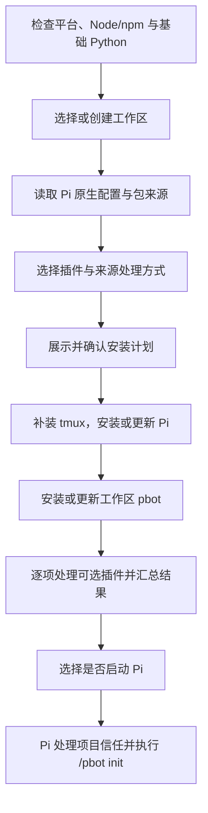

# 安装器设计

`pbot setup` 在 Linux 和 macOS 上为一个工作区安装或更新 Pi、Personal Bot 和选定插件，再启动 Pi 执行 `/pbot init`。用户命令见[项目 README](../README.zh-CN.md#安装)。dsh 使用自己的[插件与 profile 流程](dsh.md)。

## 流程与责任

安装器需要交互终端。`--workspace` 省略目录选择，仍保留插件选择和计划确认。计划列出工作区、Pi 路径、当前与目标版本、插件、自定义来源及系统安装项。系统提权、项目信任、登录和模型选择使用原生交互。

| 对象 | 处理方式 |
| --- | --- |
| Node.js/npm | 前置检查，最低 Node.js 22.19；目标软件有更高要求时先升级 |
| Pi | 当前用户共享；缺失时通过 npm 安装，已有持久安装调用原生 `pi update` |
| pbot 与可选插件 | 安装到所选工作区，使用 Pi 原生包管理 |
| tmux | 已有时复用；缺失时通过已有 Homebrew、apt、dnf、pacman、zypper 或 apk 安装 |
| Python | 检查 3.11+、venv 与 ensurepip；共享 venv 由 pbot 加载时准备 |
| 工作区资料 | 由 `/pbot init` 补建，保留已有内容 |
| 插件的外部服务 | 按对应插件的安装与配置流程处理 |

基础 Python 检查失败时，在软件变更前退出。系统适配器只安装 tmux，提权交给原生终端。升级共享 Pi 会影响其他工作区的后续启动；更换 pbot 版本前先停止活动专家。

## 插件选择

`resources/installer/plugins.json` 保存候选插件的 id、名称、说明、来源和首次默认选择。pbot 是必需项；Task Conductor 与 Pi Web Access 在首次安装时默认勾选。

已有 pbot 时按实际安装情况预选。新增候选不会自动加入；取消勾选或移出候选清单均保留现有安装。配置与安装状态来自 Pi，安装器不另建注册表。

## 版本、来源与作用域

Pi、pbot 和选中的普通 npm 插件使用最新稳定版，安装结束后核对实际版本。网络查询失败时报告错误。

| 已有来源或状态 | 行为 |
| --- | --- |
| 普通 npm 来源 | 更新所选工作区的包 |
| 本地源码、Git、固定版本或自定义范围 | 默认保留，可显式选择切换到 npm 最新稳定版 |
| 未选中的插件 | 保留声明和安装 |
| 配置损坏、来源无法辨认或重复加载 | 停止受影响步骤，保留配置并给出修复入口 |
| 用户级与项目级同名 npm 包 | 遵循 Pi 原生覆盖规则，保留用户级副本 |

Git 和本地目录必须存在，且 package.json 有有效包名；独立单文件扩展按原生声明保留。来源校验在计划和执行时都进行。切换仅修改已选定的声明，保留源码目录、历史及无关配置。

工作区包更新使用 `pi install --local npm:<package>@latest`。Pi 的 `pi update <source>` 同时匹配用户级和项目级配置，安装器不将它用于项目插件更新。首次用项目声明覆盖同名全局 npm 包时继承原资源过滤；已有项目过滤同样保留。

真实 Pi 安装须与 npx 临时缓存区分。没有 Pi 但已有包声明时，先确认安装 Pi，再使用其 SDK 读取来源。全局目录不可写、PATH 异常或无法在项目范围内切换来源时，提供原生修复步骤。

## 启动与恢复

用户选择启动后，子进程以工作区为 cwd 并继承终端，执行 `pi "/pbot init"`。Pi 完成项目信任和扩展加载后分发命令，初始化结束仍留在同一交互会话。

本次启动临时加载 `setup-guard`：若 `/pbot init` 未被注册命令处理，拦截该输入并请求 Pi 关闭，避免落入模型请求。引导文件缺失时不启动 Pi。资料创建和 Python 准备仍由 pbot 各自报告。

| 情况 | 后续处理 |
| --- | --- |
| 必要环境、tmux、Pi 或 pbot 失败 | 停止依赖步骤并显示修复方法 |
| 可选插件失败 | 继续其他插件，汇总后由用户选择是否启动 Pi |
| 下载中断或用户取消 | 保留已完成步骤；重跑时重新读取实际状态 |
| Pi 启动、初始化或 Python 准备失败 | 按所属组件的错误处理，保留安装结果 |

各包管理器独立执行，安装器不做整体回滚或删除环境来重试，也不保存安装完成标记。选择进入 Pi 后，失败的可选插件仍记为失败。

## 模块与分发

| 位置 | 责任 |
| --- | --- |
| `src/extension/setup-cli.ts` | CLI 参数、装配和退出状态 |
| `src/services/installation/` | 安装计划、选择、顺序和结果 |
| `src/integrations/installation/` | Pi/npm、系统软件、探测与进程 |
| `src/ui/setup.ts` | 目录、多选、计划确认与进度 |
| `src/extension/setup-guard.ts` | 初始化输入保护 |
| `tests/installation/` | 计划、作用域、来源和失败恢复检查 |

`bin/pbot.mjs` 转交预构建的 `lib/extension/setup-cli.js`。CLI 独立启动，发现真实 Pi 后才在子进程中使用其公开 SDK 读取配置或切换来源；宿主依赖声明为 optional peer。构建与安装包检查见[维护脚本](../scripts/README.md)。
