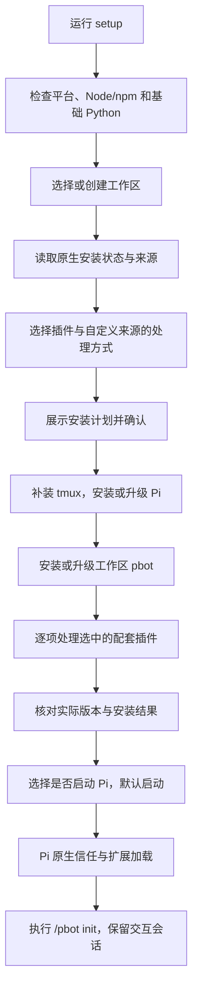

# npx 安装与升级设计

本页的独立 `pbot setup` 面向 Pi。dsh 固定版使用原生 Web profile 与插件安装流程，见[dsh 使用说明](dsh.md)；不增加配置同步、安装登记或工作区升级机制。

状态：方案已确认并实现。命令需使用包含该实现的发布包；当前源码可先执行 `npm run build:cli`，再运行 `node bin/pbot.mjs setup`。验证结果与剩余验收见[验证](validation.md)。

目标是在 Linux 和 macOS 上，通过一个交互式入口安装或升级 Pi、为一个工作区安装 Personal Bot 和选定的配套插件，再启动 Pi 执行 `/pbot init`。这里的安装路径服务于 Pi 扩展；安装命令只负责环境准备和启动。

## 命令与分发

npm 包继续使用 `personal-bot`，增加名为 `pbot` 的可执行入口。npm 上的 `pbot` 已属于其他项目，包名与命令名无需一致。

```bash
npx personal-bot@latest setup
npx personal-bot@latest setup --workspace ~/pbot-workspace
```

首次安装和后续升级使用同一个 `setup` 子命令。无子命令时显示帮助；`--workspace` 省略目录选择，但仍保留插件选择和安装计划确认。首版是终端交互流程，重定向输入时明确提示需要交互终端，不猜测选择或启动模型。

需要长期使用短命令时，用户可另行安装：

```bash
npm install -g personal-bot@latest
pbot setup
```

npx 不自动全局安装自身。全局安装只提供命令入口，不向 Pi 注册全局 pbot 扩展。`pbot setup` 使用全局安装的安装器版本；更新此入口使用 npm，或直接运行 `npx personal-bot@latest setup` 获取最新安装器。工作区中的 pbot 扩展与全局命令副本分别更新。

首版只提供 `setup`、帮助和版本信息。以后按实际需求增加子命令。

## 范围与所有者

| 对象 | 范围与责任 |
| --- | --- |
| Node.js/npm | 运行 npx 的前提；最低 Node.js 22.19，目标软件有更高要求时提示先升级 |
| Pi 主程序 | 当前用户共用一份；首次通过 npm 安装，已有安装沿用原生升级机制 |
| pbot 扩展 | 所选工作区必装；已有自定义来源可选择保留 |
| 配套插件 | 维护者提供候选清单，用户选择；安装到所选工作区 |
| tmux | 独立专家与团队协作的强依赖；缺失时通过已有系统包管理器安装 |
| 基础 Python | 检查 Python 3.11+、venv 和 ensurepip；缺失时提供指引 |
| 共享 Python venv | pbot 加载时按现有逻辑准备，安装器不维护另一份环境 |
| 工作区资料 | 启动 Pi 后交给 `/pbot init` 补建；已有内容按现有命令规则保留 |
| 模型、认证、项目信任 | 使用 Pi 原生流程与已有配置 |
| 插件依赖的外部服务 | 由插件自己的使用与配置流程处理 |

安装器每次处理一个目录。目录选择支持当前目录、输入已有目录和创建新目录，不建立工作区列表、注册表、格式版本或启用标记。新目录可由安装器创建；其中的资料目录和资料文件由 pbot 创建。Pi 原生包管理仍可创建 `.pi/settings.json` 及其安装目录。

升级共享 Pi 会影响其他工作区后续启动。更换 pbot 版本前遵循现有规则，停止活动子会话；安装器不代替用户强行终止任务。已有资料、历史记录、源码和备份保留。

## 交互流程



基础 Python 不满足要求时，在软件变更前说明缺项并结束本次 setup。tmux 安装、Pi 或 pbot 处理失败时，不继续启动 Pi。插件失败可继续处理其他插件，汇总后让用户选择是否先进入 Pi。

安装计划展示工作区绝对路径、Pi 的真实路径和安装来源、当前版本、目标版本、选中的插件、保留的自定义来源，以及需要执行的系统软件安装。用户完成一次计划确认后执行所列操作；系统提权与 Pi 信任仍使用各自原生交互。若没有 Pi、但已有原生插件声明，安装器先展示 Pi 目标版本并确认安装 Pi，再使用其原生接口读取已有来源，继续插件选择和计划确认；不猜测 Git 缓存或把已有配置当作空白。

执行结果分别说明已完成、保留、跳过和失败。退出安装阶段时不把“包安装成功”写成“模型、Python 计算或外部服务已可用”。

## 插件清单

pbot 本体作为固定必需项，不混入可选插件清单。首版候选为：

| 插件 | 来源 | 首次安装默认值 | 安装后的边界 |
| --- | --- | --- | --- |
| Task Conductor | `npm:task-conductor-plugin` | 勾选 | 安装接入插件；服务、setup 和 MCP 接入另行完成 |
| Pi Web Access | `npm:pi-web-access` | 勾选 | 安装搜索与内容获取插件；复用插件默认行为及已有配置 |

维护者通过一份随包发布的静态清单调整候选项，位置为 `resources/installer/plugins.json`：

```json
[
  {
    "id": "task-conductor",
    "label": "Task Conductor",
    "description": "周期任务、流程和 DAG 的接入与使用引导",
    "source": "npm:task-conductor-plugin",
    "defaultSelected": true
  },
  {
    "id": "web-access",
    "label": "Pi Web Access",
    "description": "网页搜索与内容获取",
    "source": "npm:pi-web-access",
    "defaultSelected": true
  }
]
```

清单只保存选择所需的元数据，不包含脚本、安装钩子、运行状态或插件专用执行逻辑。普通 npm Pi 插件只需增加清单项。安装器不提供插件市场、动态发现或用户维护清单的入口。

首次安装 pbot 时，两项默认勾选。已有 pbot 时，按当前实际安装情况预选；后来新增的候选不会自动加入。取消勾选已安装插件表示本次不处理，不卸载也不禁用。移出维护者清单的插件不再由安装器安装或升级，已有副本保留。

安装状态从 Pi 原生配置和实际包中取得，不另外持久化“安装器管理过哪些插件”。无法读取配置时报告错误，不当作全新工作区。

## 版本、来源与作用域

Pi、pbot 和选中的普通 npm 插件各自采用最新稳定版，不维护经过配套验证的固定版本组合。安装时显示当前版本和实际目标版本，结束后核对真正安装的版本。网络查询失败不能解释成“已经最新”；包版本可用也不证明整个组合已通过功能验收。

| 已有状态 | setup 的行为 |
| --- | --- |
| 没有 Pi | 使用 npm 安装官方 `@earendil-works/pi-coding-agent`，核对可执行路径和版本 |
| 已有持久安装的 Pi | 调用其原生 `pi update`；不支持自动更新时给出原安装方式的指引 |
| 缺少工作区 pbot 或选中的插件 | 使用 Pi 原生本地安装 |
| 普通 npm 来源 | 对所选工作区安装最新稳定版并核对结果 |
| 本地源码、Git、固定版本或自定义版本范围 | 展示“保留”与“切换到 npm 最新稳定版”，默认保留 |
| 清单外或本次未选中的插件 | 保持其原生声明，本次不安排升级或卸载 |
| 配置损坏、来源无法辨认或存在未解决的重复加载 | 说明冲突，停止受影响项，不自动重置配置 |

“保留”表示继续使用原有来源，不宣称它已升级到最新。选择切换后，只处理已明确选定的原声明与目标声明；保留源码目录和历史数据。不能在当前工作区内完成替换时，给出 Pi 原生操作指引，避免通过修改用户级声明影响其他工作区。

所有插件变更显式限定所选工作区。Pi 1.5 的 `pi update <source>` 会同时匹配用户级和工作区配置，且不支持 `--local`，因此不直接用它实现本安装器的工作区插件升级。普通 npm 包通过以下形式交给 Pi 安装：

```bash
pi install --local npm:personal-bot@latest
pi install --local npm:task-conductor-plugin@latest
pi install --local npm:pi-web-access@latest
```

上述命令在所选工作区执行，并按实际选择逐项调用。`latest` 用于请求当前稳定标签，保留用户已有的资源过滤配置。首次用工作区声明覆盖同身份的全局 npm 包时，将原有资源过滤继承到工作区，全局声明保持不变。必要的来源切换使用原生设置机制，不重建整个 settings 文件。底层包管理器可能重新解析共享依赖，因此验收应检查已有声明与资源过滤保持正确，不能承诺安装目录中所有依赖文件完全不变。

同一个 npm 包同时存在于用户级与工作区时，遵循 Pi 的原生覆盖规则，不更新用户级副本。本地源码、Git 与 npm 是不同身份，切换时必须核对有效加载来源，避免同时加载两份。

安装器必须区分真实 Pi 安装与 npx 临时缓存内的可执行文件；后者不能作为已经安装了持久 Pi 的证据。npm 全局目录不可写或 PATH 无法解析目标程序时，显示明确修复指引，不隐式迁移已有安装或覆盖无关命令。

## 系统依赖

tmux 存在且可执行时直接复用；缺失时使用机器已有的受支持包管理器。系统包版本遵循发行版仓库，不由 pbot 维护另一套 tmux 版本。

| 平台 | 自动补装渠道 |
| --- | --- |
| macOS | 已安装的 Homebrew |
| Linux | 显式适配的 apt、dnf、pacman、zypper、apk |

适配器只执行安装 tmux 所需的命令；不安装包管理器、不添加软件源、不顺带升级系统。需要权限时交给终端原生提权。不存在支持的包管理器或安装失败时，保留已完成步骤，提示手动完成后重跑 setup。

Python 检查沿用 pbot 的解释器选择方式：优先 PATH 中的 `python3`，其次 `python`，确认版本和创建 venv 所需能力。安装器不改系统 Python，不创建共享 venv。pbot 加载后使用现有共享锁、锁定依赖和失败重试逻辑准备环境。失败由 pbot 显示，可继续使用其他能力并按既有方式重试；不改成新的工作区启用条件。

## 启动与初始化

完成安装阶段后提供“立即启动 Pi”，默认选择启动。启动时将子进程 cwd 设为所选工作区，继承终端，不试图修改父终端目录。

正常启动语义为在该目录运行：

```bash
pi "/pbot init"
```

Pi 先处理项目信任和扩展加载，再分发启动输入。pbot 命令成功注册时，`/pbot init` 直接执行命令处理器，不需要模型认证或模型调用。初始化完成后留在同一 Pi 交互会话，登录与模型选择交给 Pi。重复 setup 后仍使用同一命令补齐缺失资料，保留已有内容。

Pi 可能把未知斜杠输入继续交给模型。本次启动显式加载一个小型引导扩展，仅拦截未被命令处理的 `/pbot init`，提示 pbot 未加载并终止该输入。Pi 原生命令分发先于 input 事件，因此正常情况仍由原有命令负责。引导扩展不创建资料、不安装软件、不取得信任或登录凭据，也不持久注册。未识别到初始化命令时请求 Pi 关闭；引导文件缺失时不启动 Pi，引导加载错误使用原生启动错误处理。

初始化与 Python 准备分别报告结果。安装器不通过等待固定时间、模拟键盘、分析提示文案或发送模型请求判断成功。用户选择暂不启动时，给出进入该目录并执行初始化的命令，不报告初始化已完成。

## 模块与发布

继续采用现有顶层分层：

| 位置 | 责任 |
| --- | --- |
| `src/extension/setup-cli.ts` | CLI 参数、依赖装配、流程入口和退出状态 |
| `src/services/installation/` | 安装计划、选择规则、执行顺序和结果汇总 |
| `src/integrations/installation/` | Pi/npm、系统包管理器、环境探测和子进程启动 |
| `src/ui/setup.ts` | 目录输入、多选、计划确认和进度展示 |
| `resources/installer/plugins.json` | 维护者提供的配套插件清单 |
| `src/extension/setup-guard.ts` | 本次 Pi 启动的初始化输入保护，随 CLI 编译发布 |
| `tests/installation/` | 安装计划、作用域、路径、真实进程与失败恢复验证 |

服务只接收普通数据和窄能力。CLI 不加载主扩展、创建 agent 会话或依赖预先安装的 Pi SDK。不同系统包管理器采用显式的少量适配，不引入动态插件执行框架。

`package.json#bin.pbot` 指向 `bin/pbot.mjs`，再转交 `lib/extension/setup-cli.js`。`npm run build:cli` 使用现有 TypeScript 编译器和独立 tsconfig.cli.json 生成 lib，包括安装入口、原生 Pi 桥接和启动保护。扩展仍由 Pi 加载源码，dist 仍仅用于测试。npm test 的构建和 prepack 都生成 CLI；消费者无需运行构建脚本。

Pi 宿主包继续作为 optional peer，不捆绑进 CLI，npx 不自动安装这些宿主依赖。CLI 入口不导入宿主；安装检查子进程在发现真实 Pi 后动态使用其公开 SDK，仅读取包配置或完成用户选择的本地来源声明替换，不创建会话、不读取认证、不启动扩展。

行为变更时同步维护中英文 README、技术设计、脚本说明、发布与验证文档，区分安装辅助命令与 Pi 中的 `/pbot` 命令。版本遵循现有发布流程，不增加存储或工作区版本计数。

## 失败、取消与重试

| 情况 | 结果 |
| --- | --- |
| Pi、pbot、tmux 或必要环境检查失败 | 停止依赖步骤，不启动 Pi，显示修复与重试方式 |
| 可选插件失败 | 继续其他独立插件，汇总后询问是否先使用 Pi |
| 下载或安装中断 | 保留已完成步骤；下次重新探测原生状态，不假定原操作已完成 |
| 用户取消 | 停止后续动作，保留已完成安装与已有资料 |
| Pi 启动失败或 pbot 未加载 | 明确区分安装结果与启动失败，不发送模型请求代替初始化 |
| pbot 初始化或 Python 准备失败 | 由 pbot 的原有命令和状态报告，不宣称环境全部就绪 |

不同包管理器不构成一个事务，不自动整体回滚，也不删除环境来重试。setup 每次重新构建计划，不建立持久执行日志或安装完成标记。进程结束时保留本次安装的失败状态；可选插件失败后选择进入 Pi，也不把该安装项改成成功。

## 验收

实现依据包括仓库代码、Pi 文档与包管理实现，以及 npm 包元数据。具体已执行检查和外部验收缺口见[验证](validation.md)。

实现至少验证以下行为：

| 场景 | 验收重点 |
| --- | --- |
| 全新环境与 npx | 不需要预装 Pi；入口能独立运行；不会把 npx 缓存中的 peer 当作真实宿主 |
| Linux 与 macOS | 真实环境中的 Pi/npm 路径、tmux 安装、交互终端和进程交接 |
| 目录选择 | 当前、已有、新建、包含空格及非 ASCII 的目录；所有操作使用所选 cwd |
| 首次安装与重复运行 | pbot 必装、默认插件、已安装预选、新候选不自动加入、再次执行正确重试 |
| 作用域与原生配置 | 同名用户级/工作区包、资源过滤、禁用资源、无关插件与损坏配置 |
| 自定义来源 | 本地源码、Git、固定版本的保留与显式切换；无重复加载，不删除源码 |
| 最新版本 | 当前版本、registry 目标与实际结果一致；查询失败和目标环境不满足时不报成功 |
| 部分失败与取消 | 依赖步骤停止、独立插件继续、重跑重新探测、不自动卸载或整体回滚 |
| 初始化交接 | 无模型认证也能执行 `/pbot init`；拒绝信任或扩展缺失时不落入模型输入；初始化后保留 TUI |
| 数据保留 | 已有 `AGENTS.md`、资料、历史记录和备份保持原有内容 |
| 打包与两种入口 | tarball 中入口和资源完整；npx 与全局 `pbot setup` 均可运行 |

测试使用实际本地文件、进程、打包产物和 Pi SDK，不使用假模型、模拟包管理器或个人凭据。测试安装目录、配置与缓存使用独立临时位置。系统包安装、联网 npm 分发与完整 TUI 在专门的 Linux/macOS 验收环境进行，不修改开发者现有环境来代替验收。

实现提交前执行 `npm run check`、`npm test`、`git diff --check` 和 `npm pack --dry-run`。本地检查不证明未来任意最新版本组合、外部服务或模型任务可用，发布记录应写明实际验收版本与剩余缺口。
